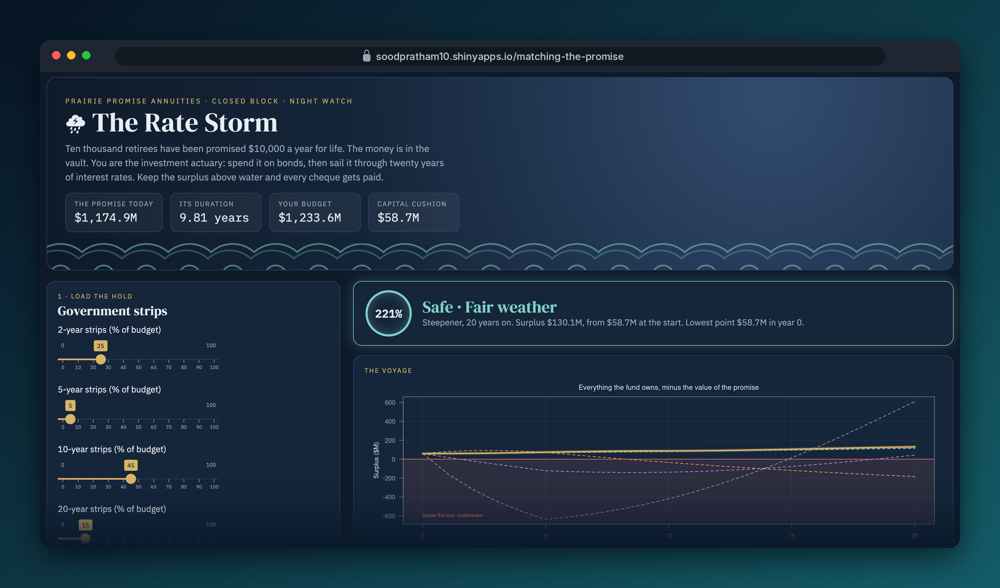
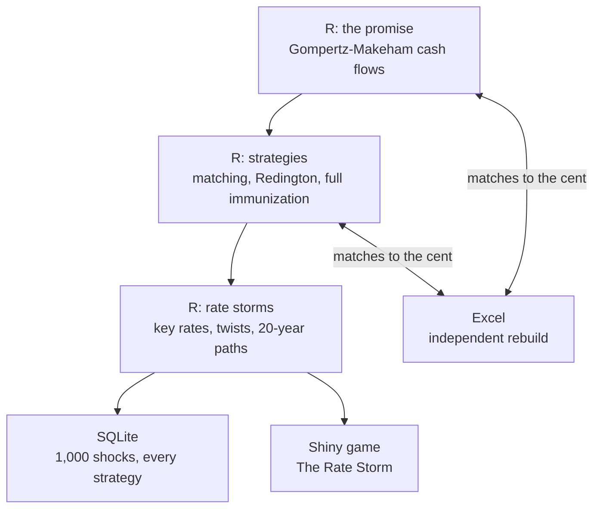

# Matching the Promise

*Ten thousand retirees. One promise. Which bonds keep it when interest rates move?*

      

**[▶ Play The Rate Storm](https://soodpratham10.shinyapps.io/matching-the-promise/)** (in your browser, no installation needed)

## You've just been made investment actuary

**Prairie Promise Annuities** is closed. It sells nothing new. All it does is keep one promise: 10,000 retirees, all aged 65, will each receive $10,000 at the end of every year for as long as they live.

The money is already in the bank: **$1.23 billion**, which is the $1.17 billion value of the promise plus 5% capital. Your job is to spend it on government bonds. Then twenty years of interest rates arrive.

- 🟢 **Safe**, 🟡 **Drifting** or 🔴 **Underwater**, judged each year on assets against the value of the promise
- ⛈ **Six storms**: calm seas, a rate crash, a rate spike, a steepener, an inversion, or a random 20-year storm
- 📰 **The Yield Curve Gazette** reports the years that mattered
- 🏆 **A report card** with a grade, a title and a Storm Survivor badge
- ⚖ **Every textbook strategy faces the same storm** next to yours: cash-flow matching, Redington, full immunization, all cash and all long
- 🎲 **Game numbers**: replay anyone's exact random storm

**[How the game works →](docs/the-game.md)**

## Prologue

An annuity is a promise with no end date written on it. The insurer knows roughly how many retirees will be alive each year, so it knows roughly what it owes. What it doesn't know is what that promise will *cost* tomorrow, because the cost depends on interest rates.

When rates fall, every future cheque is worth more today, and the promise gets heavier. Bonds gain value too, but not necessarily by the same amount. The gap between the two is the surplus, and the surplus is what stands between the retirees and a broken promise.

Asset-liability management is the craft of choosing bonds so that the gap stays positive whatever rates do. This project builds that craft one chapter at a time, and answers one question:

> Is matching the duration of the promise enough to keep it safe?

(Spoiler: no.)

## The chapters

Click a chapter to read it: the story, the mathematics, the results and the checks.

| Chapter | The story | Actuarial method | In the game |
|---|---|---|---|
| 1. [**The Promise**](docs/chapters/01-the-promise.md) | How heavy is the promise, and how much does it move? | Present value, duration and convexity of annuity cash flows | The promise you must keep |
| 2. [**Exact Matching**](docs/chapters/02-exact-matching.md) | A bond for every cheque | Cash-flow matching (dedication) | "Cash-flow matched" |
| 3. [**Immunization**](docs/chapters/03-immunization.md) | Two bonds that look right, and two that are right | Redington and full immunization | "Redington barbell", "Full immunization" |
| 4. [**Rate Storms**](docs/chapters/04-rate-storms.md) | Curves don't move in parallel | Key rate durations, twists, random shocks, 20-year storms | The storms themselves |

## What the project found

| Finding | The numbers |
|---|---|
| The promise is worth $1,174,851,028.89 at 5%, with a Macaulay duration of 9.81 years | Chapter 1 |
| A 5-year and 20-year strip pair matches the PV and the duration exactly, but its convexity is 145.25 against the promise's 150.28, so it **loses money whichever way rates move** | Chapter 3 |
| A 2-year and 30-year barbell passes all three Redington conditions, but a 1% steepening costs it **$80.6 million** | Chapters 3 and 4 |
| Full immunization loses only $1.4 million in the same twist, because its key rate durations track the promise | Chapter 4 |
| Over 20 years without rebalancing, the barbell fails the steepener storm, and fell underwater in about 4 out of 10 random storms in tuning. Full immunization and exact matching survived every storm | The game |

## How it's built

| Tool | Its job |
|---|---|
| **R** | The engine: every method built from first principles, with 130 automated tests |
| **SQL (SQLite)** | The scenario study: the promise, the shelf, each strategy's bonds and 1,000 random shocks, summarised with SQL (including the promise's PV and duration recomputed in SQL) |
| **Excel** | A second opinion: Chapters 1 to 3 rebuilt in 1,357 spreadsheet formulas, matching R to the cent on 22 checks |
| **Shiny** | The game, plus each chapter's calculator under "How it works" |

## How correctness is checked

- **Hand calculations.** Small cases worked on paper: two payments at 10%, a Redington pair for one payment at 0%, full immunization of one payment between two strips.
- **Closed forms.** A strip's duration is its maturity; key rate durations add up to the modified duration; an exact match costs exactly the PV at every rate; full immunization never shows a loss under any parallel shift from 0.1% to 15%.
- **An independent rebuild.** The Excel workbook recomputes everything in formulas and compares itself with the R engine.
- **SQL recomputation.** The promise's PV, duration and convexity are recomputed in SQL from the stored cash flows.

## Explore

- [Getting started](docs/getting-started.md): install, run the tests, build the database, open the game
- [The game](docs/the-game.md): the rules, the storms and the scoring
- [`r/`](r/) the engine · [`tests/`](tests/) the tests · [`sql/`](sql/) the queries · [`excel/`](excel/) the workbook · [`app/`](app/) the game

## About

Built by **Pratham Sood**, Actuarial Mathematics and Statistics, University of Manitoba. The idea grew out of an interest theory assignment on immunizing two liabilities. This project rebuilds it from scratch for a realistic annuity block, with its own assumptions, methods that go beyond the course, and a game.

Companion project: [The Odds of a Lifetime](https://github.com/soodpratham10/odds-of-a-lifetime), the liability side (pricing and reserving). This one is the asset side.

*All assumptions are illustrative and not calibrated to real data. Nothing here is investment advice.*
